<p align="center">
  <a href="https://github.com/ishandutta2007/Awesome-Reverse-Proxy-Management">
    
  </a>
</p>

<p align="center">
  <a href="https://github.com/ishandutta2007/Awesome-Awesome-Awesome"></a>
  <a href="https://discord.gg/jc4xtF58Ve"></a>
  <a href="https://github.com/ishandutta2007/Awesome-Reverse-Proxy-Management/stargazers"></a>
  <a href="https://github.com/ishandutta2007/Awesome-Reverse-Proxy-Management/network/members"></a>
  <a href="https://github.com/ishandutta2007/Awesome-Reverse-Proxy-Management/blob/main/LICENSE"></a>
  <a href="https://github.com/ishandutta2007/Awesome-Reverse-Proxy-Management/pulls"></a>
  <a href="https://github.com/ishandutta2007/Awesome-Reverse-Proxy-Management"></a>
  <a href="https://github.com/ishandutta2007"></a>
</p>

---

# 🚀 Awesome Reverse Proxy Management

> 🌟 **The definitive, curated ecosystem of Enterprise Application Delivery Controllers (ADCs), Cloud Ingress Gateways, and Open-Source Reverse Proxy Management Platforms.**
>
> 🎯 *Specializing in intuitive Web UI administration, automated Let's Encrypt TLS/SSL provisioning, Layer 4/Layer 7 load balancing, Zero-Trust authentication, and Docker/Kubernetes service discovery.*

---

## 📑 Table of Contents

- [📌 Introduction & Core Architecture](#-introduction--core-architecture)
- [🌐 Sector Overview & Market Dynamics](#-sector-overview--market-dynamics)
- [🏢 SaaS & Commercial Enterprise Platforms](#-saas--commercial-enterprise-platforms)
- [💻 Open-Source Reverse Proxy Ecosystem](#-open-source-reverse-proxy-ecosystem)
- [⚖️ Architecture & Feature Comparison](#️-architecture--feature-comparison)
- [🤝 How to Contribute](#-how-to-contribute)
- [💖 Support & Community](#-support--community)
- [⭐ Star History](#-star-history)
- [⚠️ Disclaimer](#️-disclaimer)

---

## 📌 Introduction & Core Architecture

A **Reverse Proxy** acts as an intermediary gateway positioned between public client networks and backend application services. Unlike forward proxies that shield client identities, a reverse proxy represents your destination servers, intercepting inbound client requests to perform critical infrastructure tasks:

- 🔒 **Automated TLS/SSL Termination & Certificate Lifecycle**: Offloading cryptographic computation and auto-renewing certificates via ACME protocols (Let's Encrypt, ZeroSSL).
- ⚖️ **L4 (Transport) & L7 (Application) Load Balancing**: Distributing workloads via round-robin, least connections, IP hash, or weighted routing.
- 🛡️ **Web Application Firewall (WAF) & DDoS Protection**: Inspecting payloads, blocking SQLi/XSS exploits, and mitigating Layer 7 volumetric floods.
- 🐳 **Dynamic Container Discovery**: Automatically spinning up and tearing down routes as Docker containers or Kubernetes pods scale.
- 🖥️ **Centralized Web UI & Control Planes**: Configuring virtual hosts, access control lists, custom headers, and stream redirects without manual text file wrangling.

Whether you run a multi-rack enterprise data center, hybrid Kubernetes clusters, or a self-hosted homelab, reverse proxy management is the backbone of reliable application delivery.

---

## 🌐 Sector Overview & Market Dynamics

The global **Application Delivery Controller (ADC), Reverse Proxy, and API Gateway market** was valued at **$4.8 Billion in 2024** and is projected to surge to **$9.6 Billion by 2030**, exhibiting a Compound Annual Growth Rate (CAGR) of **~12.4%**. This explosive growth is powered by microservices proliferation, enterprise zero-trust mandates, rapid adoption of HTTP/3 and QUIC protocols, and the explosion of edge compute architectures.

From an industry structural standpoint, the market displays a **clear two-tier bifurcation**:
1. 🏛️ **Moderately Concentrated Enterprise & Cloud Tier**: The top hyperscalers (**AWS ALB/NLB**, **Cloudflare**) and traditional ADC heavyweights (**F5 BIG-IP**, **Citrix NetScaler**) capture the lion's share of Fortune 500 infrastructure spending and mission-critical enterprise workloads.
2. ⚡ **Highly Fragmented Open-Source & Edge Tier**: In contrast, container ingress, developer platforms, and self-hosted environments represent a dynamic, highly fragmented space where open-source innovators (**Traefik**, **Caddy**, **Nginx Proxy Manager**, **Envoy Proxy**, **Kong**, and **BunkerWeb**) dominate grassroots adoption and define modern cloud-native standards.

---

## 🏢 SaaS & Commercial Enterprise Platforms

The table below outlines leading commercial reverse proxy and application delivery solutions, **sorted descending by company size (valuation / annual revenue / market cap)**:

| 🏢 Platform | 💰 Company Valuation / Revenue | 🏷️ Starting Tier Pricing | 🎁 Free Tier / Free Trial Limits | ⚡ Key Capabilities & Best For |
| :--- | :--- | :--- | :--- | :--- |
| **[AWS Application Load Balancer](https://aws.amazon.com/elasticloadbalancing/)** | 📈 **Amazon: $2.1 Trillion** (Market Cap) / **$105B+ AWS Annual Revenue** | **$0.0225 per hour** (~$16.20/month base) + **$0.008 per LCU-hour** (Load Balancer Capacity Unit) | **750 hours/month** shared across Application and Classic Load Balancers + **15 LCUs/month** for **12 months** on AWS Free Tier | Fully managed cloud L7 reverse proxy with path/host routing, native AWS WAF, gRPC, WebSocket support, and cross-AZ failover. |
| **[Cloudflare Enterprise & Load Balancing](https://www.cloudflare.com/)** | 📈 **$38.5 Billion** (Market Cap) / **$1.7B Annual Revenue** | **$5.00 per month** (Load Balancing addon for 2 origins + $0.50 per 500k queries) or **$20.00/month** (Pro Plan) | **Free Forever Plan** includes unmetered DDoS mitigation, global anycast CDN, shared SSL/TLS certificate, 3 Page Rules, and DNS management | Anycast edge reverse proxy, global traffic steering, edge caching, integrated WAF, and DDoS absorption across 330+ cities worldwide. |
| **[F5 BIG-IP](https://www.f5.com/)** | 📈 **$17.5 Billion** (Market Cap) / **$2.8B Annual Revenue** | **$6,146 perpetual license** (VE-200M Virtual Edition @ 0.2 Gbps) or **$0.866 per hour** on AWS/Azure Marketplace Pay-As-You-Go | **30-day full-feature free trial** (includes LTM, APM, AFM modules) capped at 1 Gbps throughput upon business registration | Enterprise gold-standard ADC with advanced L4-L7 traffic management, hardware ASIC SSL offloading, DDoS protection, and GSLB. |
| **[NGINX Plus](https://www.nginx.com/)** | 📈 **F5 Parent: $17.5 Billion** (Market Cap) / **$2.8B Annual Revenue** | **$3,465 per instance / year** (Basic Support annual subscription) or **$0.37 per hour** on AWS Marketplace | **30-day fully functional free trial** including live activity monitoring dashboard, dynamic API reconfigurations, and basic support | Commercial NGINX with active health checks, zero-downtime reconfiguration API, session draining, JWT validation, and App Protect WAF. |
| **[Citrix ADC (NetScaler)](https://www.netscaler.com/)** | 📈 **Cloud Software Group: $16.5 Billion** (Valuation) / **$3.2B Annual Revenue** | **$15,000 perpetual** (VPX-200 Standard @ 200 Mbps) or **$3,680 per year** annual subscription | **NetScaler VPX Express free forever developer license** (permanent, capped at 20 Mbps throughput) or **90-day evaluation trial** of VPX Enterprise | Enterprise application delivery controller offering deep content switching, app acceleration, comprehensive L4-L7 security, and ICA proxying. |
| **[Kemp LoadMaster](https://kemptechnologies.com/)** | 📈 **Progress Software: $2.7 Billion** (Market Cap) / **$750M Annual Revenue** | **$2,400 perpetual** (Virtual LoadMaster VLM-1G @ 1 Gbps throughput) or **$99.00 per month** subscription | **Free LoadMaster (VLM-Free) perpetual license** permanently capped at 20 Mbps throughput; or **30-day full-featured trial** with unlimited throughput | Turnkey load balancing with pre-configured templates for Microsoft Exchange/SharePoint, integrated WAF, and edge security pack (ESP). |
| **[A10 Networks Thunder ADC](https://www.a10networks.com/)** | 📈 **$1.15 Billion** (Market Cap) / **$260M Annual Revenue** | **$5,995 perpetual** (Thunder 930 hardware appliance) or **$0.65 per hour** (vThunder 1 Gbps) on public cloud marketplaces | **30-day free trial** of vThunder Virtual Appliance (up to 1 Gbps throughput, full feature set on AWS/Azure/GCP) | High-performance ADC engineered for massive concurrent connections, carrier-grade NAT (CGNAT), ultra-fast SSL inspection, and DDoS defense. |
| **[HAProxy Enterprise](https://www.haproxy.com/)** | 📈 **HAProxy Technologies: ~$200 Million** (Valuation) / **~$30M ARR** | **$1,400 per instance / year** (Enterprise standard subscription) or **$0.25 per hour** on AWS/Azure Marketplace | **30-day free trial** of HAProxy Enterprise with HAProxy Fusion Control Plane and enterprise WAF module access | Production-hardened HAProxy with enterprise support SLA, native GUI management (Fusion), advanced WAF, bot defense, and real-time fingerprinting. |
| **[Traefik Enterprise](https://traefik.io/)** | 📈 **Traefik Labs: ~$120 Million** (Valuation) / **~$15M ARR** | **$1,200 per node / year** (Cluster ingress tier) or **$0.18 per node / hour** on AWS/GCP cloud marketplaces | **30-day free trial** of Traefik Enterprise with distributed ACME certificate clustering, 24/7 SLA, and API gateway features | Distributed cloud-native ingress controller and API gateway with multi-cluster management, distributed ACME, and high availability. |

---

## 💻 Open-Source Reverse Proxy Ecosystem

Below are the top open-source reverse proxy and management tools, **sorted descending by GitHub Stars_Count**. Each entry features a live GitHub Stars_Badge linking directly to that project's stargazers.

### 1. 🥇 [Caddy](https://github.com/caddyserver/caddy) <a href="https://github.com/caddyserver/caddy/stargazers"></a>

- 📜 **License**: Apache-2.0
- 🌟 **GitHub_Stars**: ~78,000+
- 💡 **Overview**: The modern standard for simplicity and automated security. Written in Go, Caddy is famous for pioneering **automatic HTTPS by default** via Let's Encrypt and ZeroSSL. A two-line Caddyfile (`example.com { reverse_proxy localhost:8080 }`) automatically provisions and renews TLS certificates, configures OCSP stapling, and handles HTTP/1.1, HTTP/2, and HTTP/3 without external tools.
- ✨ **Key Features**: Dynamic configuration changes via JSON REST API without service reload; zero-dependency single binary; native HTTP/3 (QUIC) support; built-in reverse proxy with active health checks.
- 🎯 **Best For**: Developers, solo operators, and teams wanting production TLS out-of-the-box without maintaining Certbot or cron jobs.
- ⚠️ **Limitations**: Plugin compilation requires custom builds (using `xcaddy`), and ecosystem documentation is smaller compared to traditional Nginx.

---

### 2. 🥈 [Traefik](https://github.com/traefik/traefik) <a href="https://github.com/traefik/traefik/stargazers"></a>

- 📜 **License**: MIT
- 🌟 **GitHub_Stars**: ~65,200+
- 💡 **Overview**: The undisputed cloud-native reverse proxy champion. Traefik automatically discovers services by listening directly to your container orchestrator (Docker, Kubernetes Ingress / Gateway API, Consul, Nomad, etcd). Routes, services, and middlewares appear and disappear in real time as containers spin up or down.
- ✨ **Key Features**: Visual web dashboard; automatic Let's Encrypt certificates (including wildcard DNS-01 challenges); modular middleware system (Basic Auth, Forward Auth, rate limiting, circuit breakers); supports HTTP/gRPC/TCP/UDP.
- 🎯 **Best For**: Microservice clusters, Docker Compose stacks, and containerized DevOps environments that need zero-downtime routing automation.
- ⚠️ **Limitations**: Community edition does not support distributed ACME storage (cannot share certificates across multiple Traefik nodes without Traefik Enterprise).

---

### 3. 🥉 [Kong Gateway](https://github.com/Kong/kong) <a href="https://github.com/Kong/kong/stargazers"></a>

- 📜 **License**: Apache-2.0
- 🌟 **GitHub_Stars**: ~44,200+
- 💡 **Overview**: Cloud-native, high-performance API gateway and reverse proxy built on top of OpenResty/Nginx and Lua. Kong provides an enterprise-ready management plane with a declarative or database-backed configuration for controlling APIs and proxy routes.
- ✨ **Key Features**: Rich plugin ecosystem (OAuth2, Key Auth, Rate Limiting, Prometheus, CORS, OpenID Connect); declarative DB-less mode via `decK`; Kubernetes Ingress Controller integration; hybrid control/data plane architecture.
- 🎯 **Best For**: Large organizations and platform engineering teams needing centralized API management, authentication offloading, and microservice traffic governance.
- ⚠️ **Limitations**: Heavier resource footprint compared to pure reverse proxies; full GUI management features (Kong Manager) require enterprise licensing.

---

### 4. 🏅 [Nginx Proxy Manager](https://github.com/NginxProxyManager/nginx-proxy-manager) <a href="https://github.com/NginxProxyManager/nginx-proxy-manager/stargazers"></a>

- 📜 **License**: MIT
- 🌟 **GitHub_Stars**: ~34,400+
- 💡 **Overview**: The gold standard for **self-hosted, Web-UI-driven reverse proxy management**. Built on Nginx and Node.js/Express with SQLite/MariaDB, it empowers homelab builders and small businesses to manage proxy hosts, SSL certs, and access lists entirely through a clean web dashboard.
- ✨ **Key Features**: Intuitive UI for creating proxy hosts, redirection hosts, dead hosts (404), and TCP/UDP streams; one-click Let's Encrypt certificate generation with automatic renewal; user management and HTTP access lists.
- 🎯 **Best For**: Homelab enthusiasts, self-hosters, and teams who want powerful Nginx reverse proxy routing without writing configuration files.
- ⚠️ **Limitations**: Docker deployment only (no native bare-metal package); lacks built-in clustering or high-availability synchronization.

---

### 5. 🎖️ [NGINX](https://github.com/nginx/nginx) <a href="https://github.com/nginx/nginx/stargazers"></a>

- 📜 **License**: BSD-2-Clause
- 🌟 **GitHub_Stars**: ~31,900+
- 💡 **Overview**: The ubiquitous workhorse of the global web. Nginx powers over 30% of top websites, delivering unparalleled static file performance, rock-solid reverse proxying, TLS termination, and L7 load balancing via asynchronous, event-driven worker processes.
- ✨ **Key Features**: Highly modular C architecture; HTTP/2, HTTP/3, gRPC, and WebSocket support; flexible load-balancing methods (round-robin, least_conn, ip_hash); extensive caching mechanisms.
- 🎯 **Best For**: Production web infrastructure, static asset delivery, and high-concurrency gateway architectures where raw speed and proven stability are paramount.
- ⚠️ **Limitations**: Configuration is purely text-based; SSL renewal requires external tooling (Certbot); dynamic route updates without reload require NGINX Plus.

---

### 6. 🎖️ [Envoy Proxy](https://github.com/envoyproxy/envoy) <a href="https://github.com/envoyproxy/envoy/stargazers"></a>

- 📜 **License**: Apache-2.0
- 🌟 **GitHub_Stars**: ~29,100+
- 💡 **Overview**: High-performance C++ distributed service and edge proxy originally designed at Lyft. Envoy serves as the foundational data plane for modern service meshes (Istio, Linkerd) and Kubernetes ingress gateways.
- ✨ **Key Features**: Dynamic configuration via discovery APIs (xDS: LDS, RDS, CDS, EDS); advanced load balancing (zone-aware, subset, outlier detection); first-class gRPC and HTTP/2/HTTP/3 support; rich observability metrics.
- 🎯 **Best For**: Enterprise cloud-native infrastructures, microservice mesh architectures, and complex Kubernetes environments requiring programmable control planes.
- ⚠️ **Limitations**: Steep learning curve with highly verbose YAML/JSON xDS configurations; requires a dedicated control plane for dynamic management.

---

### 7. 🎖️ [Pangolin](https://github.com/fosrl/pangolin) <a href="https://github.com/fosrl/pangolin/stargazers"></a>

- 📜 **License**: AGPL-3.0
- 🌟 **GitHub_Stars**: ~23,100+
- 💡 **Overview**: A new-wave self-hosted, tunneled reverse proxy with native identity-based access control and WireGuard integration. Pangolin safely exposes internal homelab and intranet services to the internet without opening inbound firewall ports.
- ✨ **Key Features**: WireGuard-based tunneling; built-in authentication provider (OIDC, OAuth2); modern web interface for managing tunnels, domains, and access permissions.
- 🎯 **Best For**: Remote homelab access, CGNAT bypass, and Zero-Trust private network edge routing.
- ⚠️ **Limitations**: Relatively young project compared to industry veterans; focused primarily on tunnel access patterns.

---

### 8. 🎖️ [nginx-proxy](https://github.com/nginx-proxy/nginx-proxy) <a href="https://github.com/nginx-proxy/nginx-proxy/stargazers"></a>

- 📜 **License**: MIT
- 🌟 **GitHub_Stars**: ~19,900+
- 💡 **Overview**: Automated reverse proxy for Docker containers using `docker-gen`. It listens to Docker socket events and dynamically generates and reloads Nginx configurations based on container environment variables (`VIRTUAL_HOST`, `VIRTUAL_PORT`).
- ✨ **Key Features**: Zero-configuration container routing; pairs seamlessly with `acme-companion` for automatic Let's Encrypt SSL certificates; lightweight memory footprint.
- 🎯 **Best For**: Simple Docker single-host deployments wanting fully automatic reverse proxy routing without a web UI.
- ⚠️ **Limitations**: Requires mounting the Docker daemon socket (`/var/run/docker.sock`), which presents security considerations if not hardened.

---

### 9. 🎖️ [Apache APISIX](https://github.com/apache/apisix) <a href="https://github.com/apache/apisix/stargazers"></a>

- 📜 **License**: Apache-2.0
- 🌟 **GitHub_Stars**: ~17,200+
- 💡 **Overview**: Dynamic, high-performance API gateway and reverse proxy incubator from the Apache Software Foundation. Built on Nginx and LuaJIT with an etcd-based distributed control plane, APISIX supports hot-reloading routes without restarts.
- ✨ **Key Features**: Zero-downtime dynamic routing; 80+ out-of-the-box plugins; multi-language plugin runners (Go, Python, Java, Wasm); native Kubernetes Gateway API implementation.
- 🎯 **Best For**: Enterprise microservices, high-throughput financial routing, and distributed API gateway setups.
- ⚠️ **Limitations**: Requires an operational etcd cluster as the configuration storage backend, increasing operational complexity.

---

### 10. 🎖️ [OAuth2 Proxy](https://github.com/oauth2-proxy/oauth2-proxy) <a href="https://github.com/oauth2-proxy/oauth2-proxy/stargazers"></a>

- 📜 **License**: MIT
- 🌟 **GitHub_Stars**: ~15,200+
- 💡 **Overview**: Specialized reverse proxy that provides authentication with Google, GitHub, Azure AD, Keycloak, or any generic OpenID Connect (OIDC) provider, securing backend web applications without altering application code.
- ✨ **Key Features**: Seamless SSO integration; passes user identity, email, and tokens downstream via HTTP headers; supports redis/cookie session storage.
- 🎯 **Best For**: Adding multi-factor authentication and single sign-on (SSO) in front of legacy or unauthenticated web dashboards.
- ⚠️ **Limitations**: Focused purely on authentication and access control; typically used in tandem with Nginx or Traefik rather than standalone traffic shaping.

---

### 11. 🎖️ [BunkerWeb](https://github.com/bunkerity/bunkerweb) <a href="https://github.com/bunkerity/bunkerweb/stargazers"></a>

- 📜 **License**: AGPL-3.0
- 🌟 **GitHub_Stars**: ~11,100+
- 💡 **Overview**: Next-generation Web Application Firewall (WAF) integrated directly into a reverse proxy. Built on Nginx, BunkerWeb makes web security accessible by automating defense configurations out of the box.
- ✨ **Key Features**: Automated Let's Encrypt certificates; ModSecurity & OWASP Core Rule Set (CRS) integration; anti-bad bots, IP reputation checking, CAPTCHA challenges, and web admin dashboard.
- 🎯 **Best For**: Exposing public-facing applications that require immediate out-of-the-box hardening, rate limiting, and WAF defense.
- ⚠️ **Limitations**: Heavier container image and resource consumption due to deep security inspection engines.

---

### 12. 🎖️ [YARP (Yet Another Reverse Proxy)](https://github.com/dotnet/yarp) <a href="https://github.com/dotnet/yarp/stargazers"></a>

- 📜 **License**: MIT
- 🌟 **GitHub_Stars**: ~9,600+
- 💡 **Overview**: High-performance, highly customizable reverse proxy toolkit created by Microsoft on top of .NET 8/9. YARP is designed as a modular library for building tailor-made reverse proxies in C#.
- ✨ **Key Features**: Extreme throughput utilizing .NET's modern sockets engine; dynamic configuration providers; programmatic middleware pipeline for customized request transformation.
- 🎯 **Best For**: .NET enterprises building internal API gateways or customized edge ingress architectures with bespoke business logic.
- ⚠️ **Limitations**: Intended as a developer framework/SDK rather than a pre-packaged standalone binary with a GUI.

---

### 13. 🎖️ [HAProxy](https://github.com/haproxy/haproxy) <a href="https://github.com/haproxy/haproxy/stargazers"></a>

- 📜 **License**: GPL-2.0
- 🌟 **GitHub_Stars**: ~6,900+
- 💡 **Overview**: The battle-tested veteran of low-latency Layer 4 and Layer 7 proxying. Renowned across the industry for extreme stability and deterministic resource usage, handling hundreds of thousands of concurrent requests with microscopic latency.
- ✨ **Key Features**: Over 13 load-balancing algorithms; runtime API and Data Plane API for dynamic backend manipulation; advanced active health checks; rich metrics export.
- 🎯 **Best For**: High-throughput web applications, database connection proxying, and performance-critical network infrastructure.
- ⚠️ **Limitations**: No built-in ACME certificate provisioning; steeper configuration syntax learning curve.

---

### 14. 🎖️ [Zoraxy](https://github.com/tobychui/zoraxy) <a href="https://github.com/tobychui/zoraxy/stargazers"></a>

- 📜 **License**: AGPL-3.0
- 🌟 **GitHub_Stars**: ~5,500+
- 💡 **Overview**: A lightweight, general-purpose HTTP reverse proxy and routing tool with an ultra-responsive web UI written in Go. Zoraxy offers an all-in-one experience without requiring Docker.
- ✨ **Key Features**: Single standalone binary; built-in Let's Encrypt and self-signed certificate manager; virtual directories, TCP/UDP stream proxying, geo-IP blocking, and basic auth.
- 🎯 **Best For**: Users seeking the user-friendly simplicity of Nginx Proxy Manager on bare-metal Linux/BSD servers or low-spec hardware like Raspberry Pis.
- ⚠️ **Limitations**: Smaller plugin ecosystem and newer codebase compared to enterprise-proven options.

---

### 15. 🎖️ [Pomerium](https://github.com/pomerium/pomerium) <a href="https://github.com/pomerium/pomerium/stargazers"></a>

- 📜 **License**: Apache-2.0
- 🌟 **GitHub_Stars**: ~5,000+
- 💡 **Overview**: Identity-aware reverse proxy built on Envoy Proxy. Pomerium provides Zero-Trust Network Access (ZTNA) by intercepting incoming requests and authorizing users against centralized identity providers (IdPs).
- ✨ **Key Features**: Envoy data plane performance; integration with Okta, Azure AD, Google Workspace; contextual authorization policies using Open Policy Agent (OPA); built-in TLS termination.
- 🎯 **Best For**: Modern enterprises replacing legacy VPNs with perimeter-free, context-aware web proxy access.
- ⚠️ **Limitations**: Configuration can be complex for small setups; requires an external IdP to unlock full functionality.

---

### 16. 🎖️ [Caddy Docker Proxy](https://github.com/lucaslorentz/caddy-docker-proxy) <a href="https://github.com/lucaslorentz/caddy-docker-proxy/stargazers"></a>

- 📜 **License**: Apache-2.0
- 🌟 **GitHub_Stars**: ~4,700+
- 💡 **Overview**: Combines Caddy's effortless automated TLS with Docker label-based service discovery. Acts as a Caddy plugin that generates Caddyfiles dynamically from Docker container labels.
- ✨ **Key Features**: Automatic HTTPS via Caddy; zero manual config editing—just add `caddy: example.com` to your container labels; full support for Caddy directives.
- 🎯 **Best For**: Docker Compose power users who want Traefik-like label routing with Caddy's simplicity and automatic TLS engine.
- ⚠️ **Limitations**: Relies on container labels; complex custom routing rules can lead to verbose label definitions.

---

### 17. 🎖️ [SWAG (Secure Web Application Gateway)](https://github.com/linuxserver/docker-swag) <a href="https://github.com/linuxserver/docker-swag/stargazers"></a>

- 📜 **License**: GPL-3.0
- 🌟 **GitHub_Stars**: ~3,700+
- 💡 **Overview**: Maintained by LinuxServer.io, SWAG is a hardened, batteries-included Nginx reverse proxy Docker container equipped with Certbot, PHP support, fail2ban, and pre-packaged application configurations.
- ✨ **Key Features**: Turnkey reverse proxy configs for 100+ popular self-hosted apps (Plex, Nextcloud, Home Assistant); built-in intrusion prevention via fail2ban; automated cert renewals.
- 🎯 **Best For**: Self-hosters utilizing the LinuxServer.io ecosystem who prefer pre-tested, production-ready Nginx configuration snippets.
- ⚠️ **Limitations**: Configuration is file-based (no web UI); requires adjusting config files inside container volumes.

---

### 18. 🎖️ [Envoy Gateway](https://github.com/envoyproxy/gateway) <a href="https://github.com/envoyproxy/gateway/stargazers"></a>

- 📜 **License**: Apache-2.0
- 🌟 **GitHub_Stars**: ~3,100+
- 💡 **Overview**: The official Kubernetes Gateway API implementation from the Envoy Project. It simplifies running Envoy as a standardized ingress gateway in Kubernetes clusters.
- ✨ **Key Features**: Standardized `Gateway`, `HTTPRoute`, `GRPCRoute`, and `TLSRoute` custom resources; manages Envoy proxy fleet lifecycle; cloud-native observability.
- 🎯 **Best For**: Platform engineering teams standardizing on Kubernetes Gateway API with Envoy's battle-tested data plane.
- ⚠️ **Limitations**: Kubernetes-only deployment model; still evolving as the upstream Gateway API specification matures.

---

## ⚖️ Architecture & Feature Comparison

| 🛠️ Project | 🖥️ Admin UI | 🔒 Auto TLS (ACME) | 🐳 Docker Native | ☸️ K8s Ingress | ⚡ Primary Engine | 🎛️ Config Model |
| :--- | :---: | :---: | :---: | :---: | :---: | :---: |
| **Caddy** | ❌ (API only) | ✅ Built-in | 🟡 via Plugins | 🟡 via Ingress | Go | Caddyfile / JSON API |
| **Traefik** | ✅ Read-only Dashboard | ✅ Built-in | ✅ Label Discovery | ✅ Native CRD / Gateway | Go | Labels / File / Dynamic |
| **Kong Gateway** | 🟡 Enterprise UI | 🟡 via Plugin | ✅ Containerized | ✅ Native Ingress | OpenResty (Nginx + Lua) | REST API / Declarative YAML |
| **Nginx Proxy Manager** | ✅ Full Web UI | ✅ Built-in | ✅ Docker-Native | ❌ | Nginx + Node.js | Web Dashboard / SQLite |
| **NGINX** | ❌ (Plus only) | ❌ (via Certbot) | 🟡 Containerized | ✅ Ingress Controller | C (Event-driven) | nginx.conf |
| **Envoy Proxy** | ❌ (Data Plane) | 🟡 via SDS | 🟡 Containerized | ✅ Data Plane Engine | C++ | xDS API / YAML |
| **Pangolin** | ✅ Full Web UI | ✅ Built-in | ✅ Containerized | ❌ | Go + WireGuard | Web Dashboard |
| **nginx-proxy** | ❌ | 🟡 via Companion | ✅ Env Discovery | ❌ | Nginx + docker-gen | Container Env Vars |
| **Apache APISIX** | ✅ Dashboard | ✅ Built-in | ✅ Containerized | ✅ Native Ingress | Nginx + LuaJIT | etcd / Admin API / YAML |
| **OAuth2 Proxy** | ❌ | ❌ | ✅ Containerized | 🟡 Ingress Auth | Go | CLI Flags / Config File |
| **BunkerWeb** | ✅ Full Web UI | ✅ Built-in | ✅ Docker-Native | ✅ Ingress Controller | Nginx + Python | Web UI / Env Vars |
| **YARP** | ❌ (Code SDK) | 🟡 via ASP.NET | 🟡 Containerized | ❌ | .NET C# | appsettings.json / Code |
| **HAProxy** | 🟡 Enterprise UI | ❌ (External) | 🟡 Containerized | ✅ Ingress Controller | C (Event-driven) | haproxy.cfg / Data Plane API |
| **Zoraxy** | ✅ Full Web UI | ✅ Built-in | 🟡 Standalone Binary | ❌ | Go | Web Dashboard / JSON |
| **Pomerium** | 🟡 Enterprise UI | ✅ Built-in | ✅ Containerized | ✅ Ingress Controller | Go + Envoy | YAML / Ingress Annotations |
| **Caddy Docker Proxy**| ❌ | ✅ Built-in | ✅ Label Discovery | ❌ | Caddy (Go) | Docker Labels |
| **SWAG** | ❌ | ✅ Built-in | ✅ Docker-Native | ❌ | Nginx + Certbot | Nginx config templates |
| **Envoy Gateway** | ❌ | 🟡 via Cert-Manager| ❌ | ✅ Gateway API Native | Envoy (C++) | K8s Gateway API YAML |

---

## 🤝 How to Contribute

We welcome community contributions, corrections, and new project submissions!

1. 🍴 **Fork this repository**.
2. 🌿 **Create a descriptive branch**:
   ```bash
   git checkout -b add-my-reverse-proxy
   ```
3. 📝 **Add or update entries in `README.md`**:
   - Ensure you follow the existing layout and structure.
   - For SaaS products, provide verifiable, non-generic pricing and exact free tier/trial limits.
   - For Open-Source projects, include proper license, Stars_Count badge linking to stargazers, key capabilities, and limitations.
4. 📬 **Submit a Pull Request** with a concise summary of changes.

---

## 💖 Support & Community

If this curated directory helped you select, configure, or optimize your reverse proxy infrastructure:

- ⭐ **Star this repository** to help other engineers and homelabbers discover it!
- 🍴 **Fork and share** with your DevOps team or community.
- 💬 **Join our discussions** and community updates on [Discord](https://discord.gg/jc4xtF58Ve).
- ☕ **Sponsor the Maintainer**: Show your appreciation and support continuous updates via the [GitHub Sponsor Dashboard](https://github.com/sponsors/ishandutta2007).

---

## ⭐ Star History

[](https://star-history.dera.page/#ishandutta2007/Awesome-Reverse-Proxy-Management&type=date&legend=top-left)

---

## ⚠️ Disclaimer

- This repository is a community-curated, independent directory. Trademarks and product names belong to their respective owners.
- Performance characteristics (requests/sec, latency, memory consumption) vary significantly based on hardware architecture, network interface cards, kernel tuning, and specific SSL/TLS cipher suites. Always run benchmarks against your own representative production workloads.
- Publicly exposing any reverse proxy to the internet introduces security responsibilities. Always enforce rate limiting, maintain up-to-date TLS configurations, enable automated certificate renewals, and implement Web Application Firewall (WAF) protections for vulnerable web applications.

---

<p align="center">
  <b>Awesome Reverse Proxy Management</b> • Curated with ❤️ by <a href="https://github.com/ishandutta2007">Ishan Dutta</a> and community contributors.
</p>
